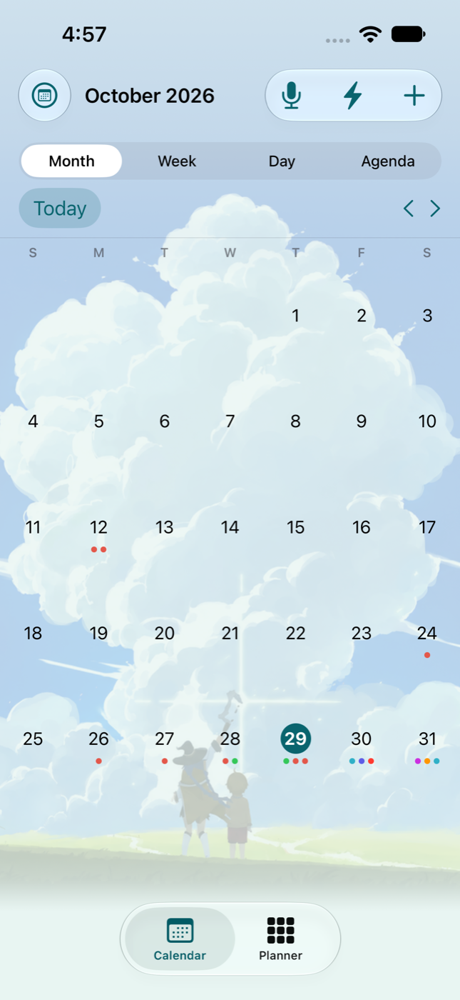
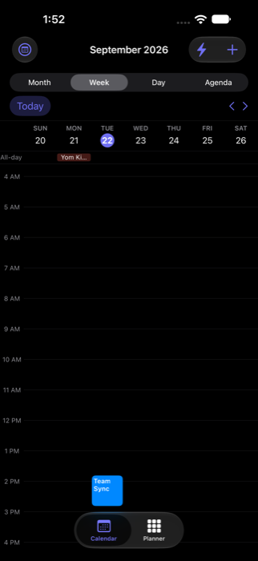
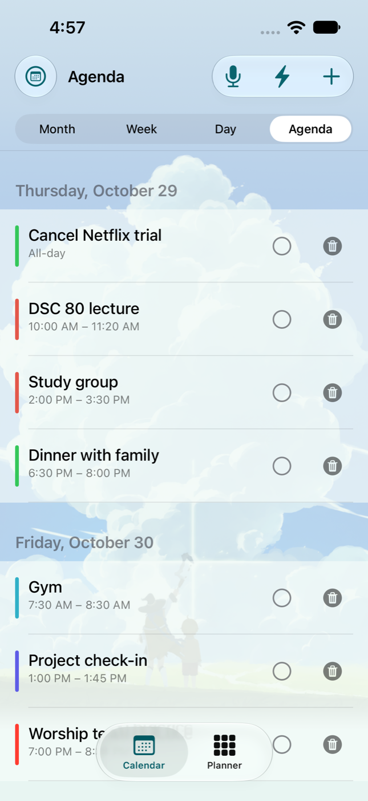

# CalendarApp

[](https://github.com/allenlong2007/CalendarApp/actions/workflows/tests.yml)

My own calendar app, for iPhone and Mac. It used to be a website, but I rebuilt it natively so it could do widgets, lock screen info, and Siri.

<p align="center">
  
  
  
</p>

## Why I rebuilt it

I made my calendar as a website first, and it worked. But a website can't sit on your home screen as a widget. It can't show up on your lock screen, and it can't talk to Siri. That stuff only works at the OS level. So I redid it as a real app.

Underneath, it uses Apple's own calendar system, so anything you add syncs through iCloud like normal and shows up in the regular Calendar app too. I also added a "Planner," a separate space for sketching out a week before it becomes real events, along with quick templates, saved addresses, and undo for anything you delete by accident.

## What it can do

There are Month, Week, Day, and Agenda views, plus a full event editor with location search. Planner mode lets you rough out a week before committing to real events. You can mark things done, and undo deletes or changes. Widgets show your next event or the day's schedule on the home screen and lock screen. Siri can add an event or tell you what's next. It runs as an actual Mac app too, not just on iPhone. Everything from my old website calendar got pulled in during a one time import, so switching over didn't lose any history. Gmail import is in there as well, off by default, for catching events buried in email.

## Calendar background

The app uses a light seafoam palette with teal controls. On Mac and iPhone, open the calendar button → Appearance → Calendar Background to choose an image from Photos or Files, adjust its opacity, or turn it off. The included cloud artwork is enabled by default. On Mac, the image stretches to the window bounds so resizing leaves no blank bands or cropped image edges. The native toolbar auto-hides in full screen; move the pointer to the top edge to reveal the Calendar/Planner tabs. Phone backgrounds fill the screen proportionally. Custom images and appearance settings stay on the device; they do not sync through iCloud.

On Mac, the month grid fits three complete weeks to the available height, or two when the grid is shorter than 330 points. Rows stay aligned when resizing.

On iPhone, swipe horizontally to switch months, weeks, or individual days. Portrait Month shows only that month's dates. Rotating into landscape from any calendar tab opens Month with a compact header and the focused week plus the next week, Sunday through Saturday. Tap a date in either orientation to open its Day tab, where horizontal swipes move one day at a time. Swipe or use the arrows in the landscape week grid to move by a week, and tap Today to return to the current week.

Voice accepts commands such as “Add the event from the email from my dentist about my appointment.” With Gmail connected, choose a matching email and review its event details before confirming. You can also paste email text without connecting Gmail. Multiple dates prompt a choice; missing dates or times need clarification rather than using the email's received time.

Gmail supports multiple accounts: connect the first inbox, then use Add Gmail Account for each additional inbox. Voice searches all connected accounts and labels results by inbox. Tokens stay separately in Keychain on each device. The Google Cloud project `calendarapp-512618` has Gmail API enabled and its native public OAuth client configured. The three requested accounts are allowed as test users; each still needs to authorize read-only access in the app. Testing-mode Google authorizations may require reconnecting periodically.

Open the calendar button → Gmail Accounts to manage connections directly. On Mac, Google sign-in opens in the normal browser and returns to CalendarApp through its registered callback URL. The app validates the callback state and PKCE exchange before saving an account. On iPhone, sign-in uses the system authentication session.

## Built with

Swift, SwiftUI, EventKit, SwiftData, WidgetKit, Siri Shortcuts, MapKit, XcodeGen.

## How it works

Real events live in EventKit, Apple's own calendar system. That means they sync for free and show up in the actual Calendar app too, with no extra syncing code needed on my end. Everything else the app does that a normal calendar can't, like Planner, marking things done, saved addresses, and templates, sits in its own local database on the device. It's set up to sync that through iCloud too, but that part is switched off for now since it needs a paid Apple developer account.

Widgets and Siri both read from that same data, so however you check your schedule, it's coming from one place.

## Running it

```bash
git clone https://github.com/allenlong2007/CalendarApp.git
cd CalendarApp
xcodegen generate
open CalendarApp.xcodeproj
```

Needs [XcodeGen](https://github.com/yonaskolb/XcodeGen) (`brew install xcodegen`) and Xcode. Pick the CalendarApp scheme, let it have calendar access, and run it. Gmail requires a Google OAuth iOS client ID in `CalendarApp/Gmail/GoogleOAuthConfig.swift` and the Gmail API enabled for its Google Cloud project. The app requests read-only Gmail access; no client secret belongs in the app.

## Tests

There are unit tests for the date math behind the Month and Week grids (week start days, 42 day month layouts, month lengths) and for how dates get pulled out of email text. Run them with Cmd+U in Xcode, or:

```bash
xcodebuild test -project CalendarApp.xcodeproj -scheme CalendarApp -destination 'platform=iOS Simulator,name=iPhone 17'
```

## Status

I use it every day, on iPhone and Mac both. Never put it on the App Store. It's just for me.
